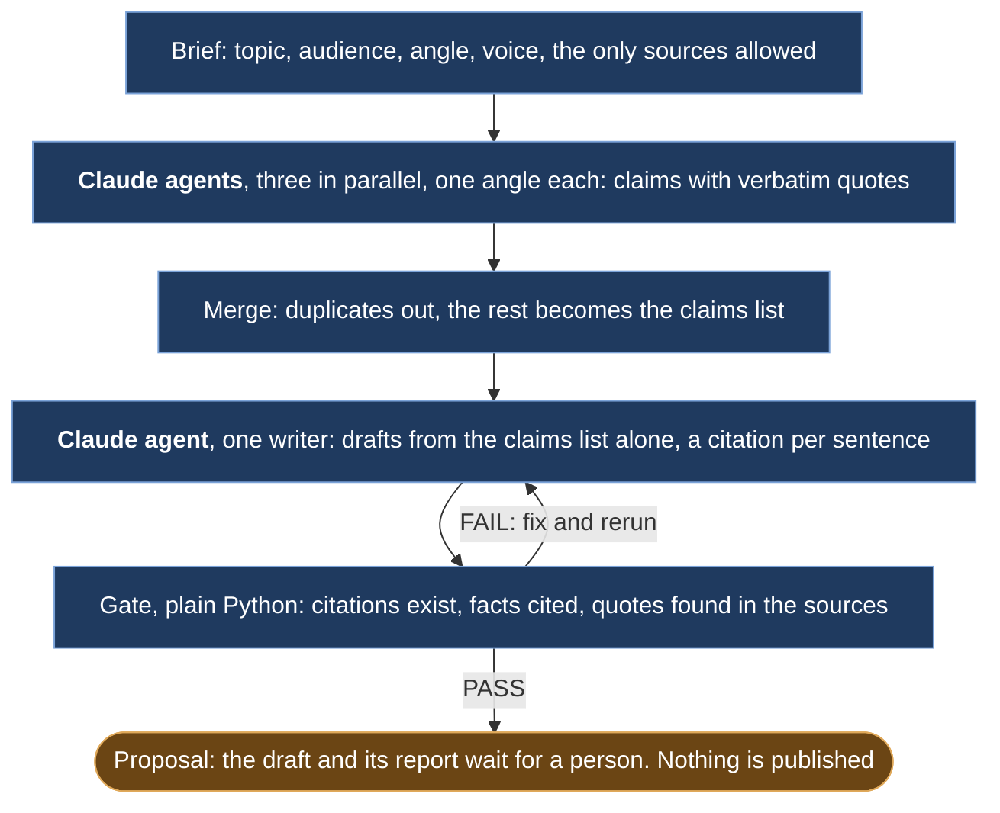

# article-pipeline

Drafts a long-form article from sources you chose, with a citation after every factual sentence and a fact-check report that must say PASS before you read it.

## Preview

```text
$ article-pipeline new offline-first \
    --topic "Why small field teams adopt offline-first apps" \
    --source notes/survey-notes.md --source https://example.org/essay
Created runs/2026-10-16-offline-first/
  brief.md      topic: Why small field teams adopt offline-first apps
  sources.md    2 source(s): S1, S2
Next: fill in audience and angle in brief.md, then run the skill.

$ claude
> /article-pipeline runs/2026-10-16-offline-first
  ... three research agents, merge, one writer ...

$ article-pipeline status runs/2026-10-16-offline-first
runs/2026-10-16-offline-first/
  [x] 1 brief       brief.md
  [x] 1 sources     sources.md (1 local file)
  [x] 2 research    research/ (3 files)
  [x] 3 merge       claims.md
  [x] 4 draft       draft.md
  [ ] 5 fact check  factcheck.md

$ article-pipeline check runs/2026-10-16-offline-first
FAIL  runs/2026-10-16-offline-first/factcheck.md
  sentences: 42 (24 cited)
  claims: 22 (22 quotes verified, 0 remote not fetched)
  problems: 1
  - uncited sentence (draft.md): contains a number: The median crew spent 3 hours a day offline.

$ article-pipeline check runs/2026-10-16-offline-first
PASS  runs/2026-10-16-offline-first/factcheck.md
  sentences: 42 (25 cited)
  claims: 22 (22 quotes verified, 0 remote not fetched)
```

## What it does



1. Brief: `brief.md` holds topic, audience, angle, voice and the only sources allowed.
2. Research: three Claude Code subagents run in parallel, one angle each, and list claims with verbatim quotes and source ids.
3. Merge: duplicates go, the rest becomes `claims.md`.
4. Write: one subagent drafts from `claims.md` alone, citing `[S#]` after every factual sentence.
5. Gate: `article-pipeline check` verifies citations, uncited facts and quotes, and writes `factcheck.md` with PASS or FAIL.
6. Proposal: `draft.md` and `factcheck.md` wait in the run folder for a person. Nothing is published.

**Constraints:** the gate is plain Python, no model call, no network, exit 1 on FAIL. The research and writing steps run as Claude Code subagents from the skill.

## Why this exists

The original produced the long-form pieces placed on independent industry platforms: a fixed set of sources, research in parallel, one writer, a verification pass before anything went out. I rebuilt the pattern here in October 2026, fresh and generic, and made the gate a plain script. The sample run uses invented sources about an invented topic. The original is described in [Parallel research, one writer](https://github.com/nunomnferreirapt/ai-operated-growth-engine/blob/main/architecture/patterns/research-writer.md), a note in the showcase it came from.

## Requirements

- Python 3.12 or later and [uv](https://docs.astral.sh/uv/)
- Claude Code, for the skill. The CLI works without it.

## Install

```bash
git clone https://github.com/nunomnferreirapt/article-pipeline.git
cd article-pipeline
uv sync
cp -R skill ~/.claude/skills/article-pipeline
```

First run, on the sample: `uv run article-pipeline check examples/sample-run`.

The skill calls the `article-pipeline` command. If the clone's environment is not on your PATH, open `~/.claude/skills/article-pipeline/SKILL.md` and put the clone path into its "Before you start" line (`uv run --project <path-to-clone> article-pipeline`). `skill/README.md` has the two options.

## Usage

In Claude Code: `/article-pipeline`, then answer the questions about topic and sources. It runs the six steps and stops at the proposal.

CLI:

- `article-pipeline new <slug> --topic "..." --source <url-or-path> [--source ...]` creates the run folder with `brief.md`, `sources.md` and copies of local sources.
- `article-pipeline check <run-dir>` runs the gate, writes `factcheck.md`, exits 1 on FAIL.
- `article-pipeline status <run-dir>` lists which stages exist.

**With platform-profile.** If you keep a [platform-profile](https://github.com/nunomnferreirapt/platform-profile) of the company, its `sources/*.md` files are the sources to pass here: `--source <profile>/sources/pricing.md`. The pages are already clean markdown with the URL and fetch time on top, so the gate can check every quote against them. That is how the original ran: the writer drew only on the crawled, versioned copy of what the company had published.

## How the gate works

The gate is plain Python: no model call, no network. It reads `draft.md` sentence by sentence, skipping headings. Any `[S#]` missing from `sources.md` is a problem. Any sentence with a digit, or with a capitalized word that is not its first word, needs a citation, so figures, years, percentages and names cannot slip in unsourced. Then it looks for each quote in `claims.md`, lowercased with whitespace collapsed, inside its local source file; remote sources are skipped and counted. The skill fixes and reruns until PASS and never hands over a FAIL.

## Repository layout

```text
article-pipeline/
  skill/
    SKILL.md              what Claude Code follows
    README.md             how to install the skill
  src/article_pipeline/
    cli.py                new, check, status
    check.py              the gate
    scaffold.py           run folder creation
    status.py             stage report
    run.py                sources.md and claims.md parsing
  tests/                  15 tests, run with `uv run pytest`
  examples/sample-run/    one complete run on invented sources
  pyproject.toml
  LICENSE
```

## License

MIT. See `LICENSE`.

Built by [Nuno Ferreira](https://www.linkedin.com/in/nunomnferreira).
